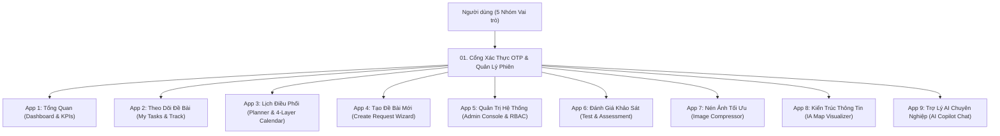

# 📚 TỔNG HỢP TOÀN BỘ 9 PHÂN HỆ ỨNG DỤNG (APPS) & TÍNH NĂNG HỆ THỐNG
## MB UX Task Request Portal — Architecture & Feature Specification

---

## 1. Bản đồ tổng thể 9 Phân hệ (The 9 Core Applications)

Hệ thống MB UX Task Request Portal được kiến trúc theo mô hình Single Page Application (SPA) hiệu năng cao, phân chia thành 9 phân hệ ứng dụng độc lập nhưng tương tác dữ liệu đồng bộ thời gian thực qua State Bus (`realtimeSyncService`) và kết nối dữ liệu đám mây (Google Sheets API & Google Drive Storage):

---

## 2. Chi tiết Đặc tả Tính năng 9 Phân hệ

### 2.1. Phân hệ 1: Tổng Quan (Dashboard & Executive KPIs)
- **Mã trang:** `TongQuanPage.tsx`
- **Mục tiêu:** Cung cấp thông tin điều hành vĩ mô cho Design Lead và Ban Giám đốc Khối, phản ánh chính xác hiệu suất và phân bổ nguồn lực thiết kế.
- **Tính năng cốt lõi:**
  1. **Thẻ chỉ số điều hành (AiOps KPI Cards):**
     - Tổng số đề bài đang chạy (Active Tasks).
     - Đề bài hoàn thành đúng hạn (On-Time Delivery Rate %).
     - Đề bài trễ hạn / có nguy cơ trễ hạn (At-Risk / Overdue).
     - Thời gian chu kỳ trung bình (Average Cycle Time).
  2. **Biểu đồ phân bổ nguồn lực (Squad & Designer Workload):**
     - Thống kê tỷ lệ tải công việc của từng Designer trong các Squad (Bán lẻ, Doanh nghiệp SME, Digital Banking, Platform, v.v.).
     - Trực quan hóa số giờ khả dụng còn lại theo tuần.
  3. **Biểu đồ trạng thái Khâu UX (UX Phase Distribution):**
     - Nhận diện điểm nghẽn tại từng giai đoạn thiết kế (Briefing, Wireframe, UI Design, Design System, Handover Dev).
  4. **Bộ lọc điều hành thông minh:** Lọc theo Quý, Tháng, Squad, Mức độ ưu tiên (Lv1 đến Lv5).

---

### 2.2. Phân hệ 2: Theo Dõi Đề Bài (My Tasks & Track Request)
- **Mã trang:** `TrackRequestPage.tsx`
- **Mục tiêu:** Không gian làm việc hàng ngày của PO, Designer và Quản lý để quản lý vòng đời đề bài.
- **Tính năng cốt lõi:**
  1. **Chế độ xem kép (Kanban Board & Grouped Data Table):**
     - **Bảng Kanban:** Kéo thả task giữa các cột trạng thái (Tiếp nhận -> Đang thực hiện -> Review -> Hoàn thành). Hỗ trợ Ribbon nhận diện trạng thái đặc biệt (Pending, Freeze, Reject).
     - **Bảng Dữ liệu thu gọn:** Cột cố định (Sticky Action Column), nhóm theo Squad hoặc Designer, tìm kiếm tức thì theo tiêu đề, mã task, nickname.
  2. **Ngăn kéo thông minh (Smart Drawer - `RequestDetail.tsx`):**
     - Quản lý đầy đủ thông tin: Người yêu cầu, Đơn vị, Mục tiêu kinh doanh, Đối tượng người dùng, Đầu ra mong muốn.
     - Thanh Stepper & Thanh tiến độ (%) cập nhật trực tiếp.
     - Cập nhật trạng thái nâng cao:
       - **Chờ PO phản hồi (Pending):** Đính kèm lý do pending, gửi thông báo trigger `@SendToPO`.
       - **Dừng task (Freeze):** Ghi nhận lý do dừng (`freeze_reason`), ngày dừng (`frozen_at`), tạm dừng đếm SLA.
       - **Từ chối task (Reject):** Ghi nhận lý do từ chối (`rejected_reason`), ngày từ chối (`rejected_at`), đóng lưu trữ.
       - **Đổi ngày dự kiến làm (`planned_work_date`):** Tách biệt với deadline cam kết, không làm sai lệch SLA ban đầu.
     - Nhật ký trao đổi (Activity & Comment Timeline) với bộ lọc hệ thống / bình luận người dùng.
  3. **Đồng bộ thời gian thực (0ms Real-time Bus):** Cập nhật dữ liệu tức thì giữa các tab trình duyệt qua `BroadcastChannel`.

---

### 2.3. Phân hệ 3: Lịch Làm Việc & Điều Phối (Designer Planner & Team Calendar)
- **Mã trang:** `DesignerPlannerPage.tsx`, `CalendarPage.tsx`
- **Mục tiêu:** Điều phối lịch trình làm việc, lịch họp, lịch nghỉ phép và phòng ngừa rủi ro quá tải nhân sự.
- **Cấu trúc Động cơ 4 Tầng Dữ Liệu (4-Layer Engine):**
  - **Tầng 1 (UX Tasks & Deadlines):** Lịch dự kiến làm và hạn chót giao bài của các nhiệm vụ thiết kế.
  - **Tầng 2 (Lịch nghỉ phép cá nhân):** Tự động đồng bộ từ Google Sheet Nghỉ phép, trừ ngày nghỉ khỏi quỹ giờ làm việc của Designer.
  - **Tầng 3 (Lịch ngân hàng & Ngày lễ):** Cập nhật lịch nghỉ lễ quốc gia, ngày làm bù cuối tuần theo quy định MBBank 2026.
  - **Tầng 4 (Sự kiện team nội bộ):** Lịch họp Design Critique, Workshop, Họp Squad, Đào tạo nội bộ.
- **Tính năng nâng cao:**
  - **Executive Summary Typewriter:** Trợ lý ảo tóm tắt kế hoạch tuần theo dạng gõ máy chữ, highlight các đề bài ưu tiên cao và cảnh báo rủi ro.
  - **Kéo thả xếp lịch (Drag & Drop Planner):** Kéo task từ danh sách chưa xếp lịch thả vào ngày cụ thể trên lưới lịch tuần/tháng.
  - **Hộp thoại Đặt lịch họp (`ScheduleMeetingDialog`):** Hỗ trợ đính kèm ảnh thumbnail, chọn Designer tham gia, phòng họp hoặc link Google Meet / Teams.

---

### 2.4. Phân hệ 4: Tạo Đề Bài Mới (Create Request Wizard)
- **Mã trang:** `CreateRequestPage.tsx`
- **Mục tiêu:** Cổng tiếp nhận yêu cầu thiết kế chuẩn hóa từ các PO và đơn vị kinh doanh.
- **Tính năng cốt lõi:**
  1. **Quy trình nhập liệu nhiều bước (Multi-step Form):** Tránh quá tải thông tin, hướng dẫn PO điền rõ ràng bài toán kinh doanh và đầu ra kỳ vọng.
  2. **Ma trận tính toán độ ưu tiên (Priority Matrix Lv1 - Lv5):** Tự động đề xuất cấp độ ưu tiên dựa trên quy mô người dùng và mức độ khẩn cấp.
  3. **Tải lên tệp đính kèm an toàn (`FileUpload.tsx`):**
     - Kiểm tra định dạng tệp và dung lượng (<25MB) phía client.
     - Đẩy tệp trực tiếp lên thư mục Google Drive dự án và tự sinh URL xem nhanh.
  4. **Tự động lưu nháp (15-second Auto-save):** Bảo vệ dữ liệu đang nhập không bị mất khi vô tình đóng tab hoặc mất mạng.

---

### 2.5. Phân hệ 5: Quản Trị Hệ Thống (Admin Console & Permissions)
- **Mã trang:** `QuanLyPage.tsx`
- **Mục tiêu:** Trao toàn quyền cấu hình, vận hành và giám sát hệ thống cho Quản trị viên (Admin) và Lead Designer.
- **Tính năng cốt lõi:**
  1. **Phân quyền truy cập theo vai trò (RBAC):** Bật/tắt quyền truy cập từng menu cho 5 nhóm tài khoản: Admin, Design Owner, Designer, PO, Business.
  2. **Quản lý danh sách thành viên & Đội ngũ:** Quản lý tài khoản, gán Squad chuyên trách, email nhận thông báo.
  3. **Cấu hình phiên làm việc kép (Dual Session Policy):** Thiết lập phiên cố định 8 tiếng (Fixed 8h) cho Admin hoặc phiên trượt 24 tiếng (Sliding 24h) cho Designer/PO.
  4. **Cấu hình Kết nối Google Sheet & Drive Cloud:** Kiểm tra trạng thái kết nối Web App, đồng bộ dữ liệu Master (Sản phẩm, Squad, Khâu UX).
  5. **Bảng thông báo khẩn cấp (Emergency Banner):** Phát thông báo tức thì lên đầu trang cho tất cả người dùng khi có sự kiện bảo trì hoặc thông báo đặc biệt.

---

### 2.6. Phân hệ 6: Đánh Giá Khảo Sát & Đào Tạo (Test Assessment)
- **Mã trang:** `TestAssessmentPage.tsx`
- **Mục tiêu:** Khảo sát năng lực, tổ chức bài kiểm tra trắc nghiệm Design System và đánh giá tiêu chuẩn chất lượng.
- **Tính năng cốt lõi:**
  - Giao diện làm bài trực quan, đồng hồ đếm ngược thông minh.
  - Chấm điểm tự động và phản hồi đáp án chuẩn.
  - Báo cáo thống kê phân phối điểm và lịch sử làm bài của từng Designer.

---

### 2.7. Phân hệ 7: Nén Ảnh Tối Ưu (Image Compressor)
- **Mã trang:** `ImageCompressorPage.tsx`
- **Mục tiêu:** Công cụ hỗ trợ xử lý hình ảnh nội bộ cho Designer trước khi xuất file đính kèm.
- **Tính năng cốt lõi:**
  1. **Hỗ trợ định dạng rộng rãi:** PNG, JPG, JPEG, chuyển đổi tự động sang **WebP** chuẩn nén hiện đại.
  2. **Thanh trượt tùy chỉnh chất lượng & tỷ lệ (Quality & Scale Sliders):** Điều chỉnh linh hoạt độ nét và kích thước pixel.
  3. **So sánh Trước/Sau (Before/After View):** Hiển thị trực quan mức dung lượng giảm thiểu (tiết kiệm đến 70-90% dung lượng).
  4. **Tải về hàng loạt dạng ZIP:** Đóng gói toàn bộ các ảnh đã nén thành 1 tệp `.zip` thông qua thư viện JSZip.

---

### 2.8. Phân hệ 8: Sơ Đồ Kiến Trúc Thông Tin (IA Map Visualizer)
- **Mã trang:** `IAPage.tsx`
- **Mục tiêu:** Không gian trực quan hóa cấu trúc sơ đồ luồng người dùng (User Flow), sitemap và kiến trúc thông tin sản phẩm số MBBank.
- **Tính năng cốt lõi:**
  1. **Canvas vô cực (Infinite Canvas - 60fps GPU acceleration):** Hỗ trợ Pan chuột giữa/phím H, Zoom cân xứng Ctrl+Wheel, Mini-map định vị và bắt lưới điểm.
  2. **Hệ thống phân tầng chuẩn hóa (Tier 1 đến Tier 5):**
     - Lv1: Tên Sản phẩm (Product Root)
     - Lv2: Phân hệ / Module
     - Lv3: Hành trình người dùng (Journey) - Bố cục dàn ngang thông minh
     - Lv4: Màn hình chi tiết (Screen) - Bố cục xếp dọc
     - Lv5: Phần tử giao diện (UI Element)
  3. **Vô hiệu hóa Node (Disable Node) với lan truyền phân cấp (Cascade):**
     - Đổi nền sang xám, độ mờ 70%, gạch ngang tiêu đề, đổi connector sang nét đứt.
     - Tự động áp dụng xuống toàn bộ cây con trực thuộc mà không ảnh hưởng sang các nhánh khác.
  4. **Liên kết đề bài (Task ↔ IA Linking):** Gắn mã đề bài trực tiếp vào từng node màn hình để theo dõi tiến độ thiết kế tương ứng.
  5. **Tối ưu hóa hiệu năng cao (Viewport Culling & Auto-chunking):** Chỉ render các node nằm trong tầm nhìn màn hình (giảm hơn 80% DOM), tự động cắt nhỏ dữ liệu thành các chunk <= 40,000 ký tự khi đồng bộ với Google Sheets.

---

### 2.9. Phân hệ 9: Trợ Lý AI Chuyên Nghiệp (AI Copilot Chat)
- **Mã trang:** `AIChatPage.tsx`
- **Mục tiêu:** Trợ lý AI hỗ trợ giải đáp quy chuẩn thiết kế, tra cứu thông tin đề bài và thực thi tác vụ quản trị thông minh.
- **Tính năng cốt lõi:**
  1. **Hội thoại có bối cảnh sâu (Grounded Context Intelligence):**
     - Nhận diện linh hoạt mã đề bài, nickname, hashtag hoặc tên viết tắt.
     - Duy trì ngữ cảnh Active Task xuyên suốt nhiều lượt chat mà không bị rơi rụng thông tin.
  2. **Tra cứu tri thức tài liệu (Grounded RAG Retrieval):** Tự động tìm kiếm các quy định, guideline Design System đã phê duyệt trong kho tri thức nội bộ và trích dẫn nguồn chuẩn xác, ngăn chặn ảo giác (hallucination).
  3. **Trình xem tài liệu song song (Echo Artifact Split Viewer):**
     - Màn hình chia đôi với thanh kéo điều chỉnh kích thước linh hoạt.
     - Hiển thị tài liệu chi tiết, bảng dữ liệu, biểu đồ Mermaid, code mẫu bên cạnh luồng chat.
  4. **Thực thi lệnh nhanh:** Hỗ trợ các lệnh `/freeze` (dừng task), `/reject` (từ chối task) cập nhật trạng thái trực tiếp vào hệ thống.

---

## 3. Kiến trúc Đồng bộ & Bảo mật

1. **Bảo mật phiên (Session Security):** Quản lý phiên làm việc bằng token ngẫu nhiên gắn với CSRF token, tự động kiểm tra hết hạn và gửi cảnh báo trước 15 phút.
2. **Cơ chế chống tràn dữ liệu (Defensive Architecture):**
   - Lọc bỏ dữ liệu test khỏi môi trường production (`filterProductionTasks`).
   - XSS sanitization làm sạch toàn bộ dữ liệu nhập vào form.
   - Giới hạn kích thước payload và tự động phân mảnh dữ liệu lớn khi lưu trữ đám mây.
3. **Môi trường phát triển cục bộ:** Đăng nhập nhanh với OTP mặc định `123456` phục vụ dev và test độc lập.
