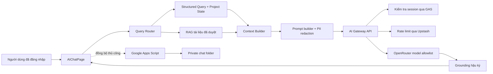

# 14 — AI Chats & Intelligent Copilot

> **Module/phạm vi:** Trợ lý tra cứu thông tin task và quy định/quy chuẩn UX MBBank
> **Owner:** UX Platform / Design Ops
> **Thời gian đọc mục tiêu:** 15 phút
> **Trạng thái:** Read-only, gateway-managed, fail-closed
> **Last Updated:** 2026-10-24

## 1. Tổng quan và kiến trúc

AI Chats phục vụ đúng hai nhu cầu:

1. Tra cứu task người dùng được phép xem: yêu cầu, trạng thái, khâu, người phụ trách, deadline, rủi ro và cập nhật gần nhất.
2. Tra cứu quy định/quy chuẩn từ tài liệu đã được duyệt.

AI Chats không cập nhật task, không phê duyệt, không gửi thông báo và không giả lập rằng một hành động đã được thực hiện.



### Nguyên tắc tin cậy

- Dữ liệu task được lọc theo session và vai trò trước khi đưa vào prompt.
- PII trong context được redaction một chiều.
- Context truy xuất được đóng vai trò dữ liệu tham chiếu, không phải chỉ thị.
- Mã task không tồn tại trong context bị thay bằng dấu hiệu chưa xác minh.
- Tài liệu upload tùy chỉnh chỉ được dùng như quy chuẩn chính thức khi `approvalStatus === "approved"`.
- Activity trace chỉ mô tả các bước ứng dụng đã thực hiện; không hiển thị chain-of-thought thô.

## 2. Bản đồ file và mã nguồn

| File | Trách nhiệm | Điểm cần chú ý |
|---|---|---|
| `src/pages/AIChatPage.tsx` | UI, thread, composer, task context, cloud sync | Chỉ hiển thị hai nhóm OP; cloud sync là opt-in |
| `src/config/aiPrompts.ts` | Phạm vi, prompt, metrics, retrieval tài liệu | Không đưa action/task-update schema vào prompt chat |
| `src/lib/aiConversation.ts` | Resolve task, memory, grounding | Không tự chọn task khi có nhiều ứng viên |
| `src/lib/aiProjectState.ts` | Snapshot KPI task xác định, version hóa | Chỉ tính trên task scope đã được cấp quyền |
| `src/lib/aiRetrievalPipeline.ts` | Query router, structured task payload, RAG | Tách số liệu chính xác khỏi phần diễn đạt của LLM |
| `src/services/aiService.ts` | Streaming qua gateway và fallback an toàn | Không gọi trực tiếp provider từ browser |
| `src/services/aiArtifactsService.ts` | Kho artifact và metadata phê duyệt | Custom artifact chưa duyệt không phải nguồn quy chuẩn |
| `src/services/googleSheetService.ts` | Đồng bộ task đã xác thực | Cache task tách theo danh tính người dùng |
| `src/components/common/EchoChartsAndFlowcharts.tsx` | Chart và Mermaid | Mermaid strict + SVG sanitizer |
| `src/components/admin/OpenRouterSettingsCard.tsx` | Bật/tắt gateway, chọn model allowlist | Không nhập hoặc lưu provider key ở client |
| `api/ai-gateway.ts` | Auth, rate limit, model policy, proxy LLM | Production fail-closed |
| `google-apps-script-backend.js` | Session, task access, upload, chat cloud | Chat lưu trong thư mục Drive riêng tư |

## 3. Luồng dữ liệu và trạng thái

### Luồng một câu hỏi

1. UI lấy session hiện tại và danh sách task đã được backend lọc quyền.
2. `resolveTaskReference` xác định task theo mã, nickname hoặc ngữ cảnh hội thoại.
3. Nếu mơ hồ, UI yêu cầu người dùng chọn tối đa ba ứng viên.
4. `buildProjectState` tính KPI/deadline từ đúng task scope và tạo `version` ổn định cho snapshot.
5. RAG chỉ nạp tài liệu seed được quản trị hoặc custom artifact có `approvalStatus === "approved"`.
6. Context Builder ghép Project State, task liên quan và trích đoạn tài liệu; dữ liệu tham chiếu không được coi là instruction.
7. `aiService` gửi request tới `/api/ai-gateway` kèm bearer session, không kèm provider key.
8. Gateway xác minh session bằng POST tới GAS, áp rate limit và model allowlist.
9. `groundAIResponse` kiểm tra mã task và gắn danh sách nguồn tham chiếu đã nạp.
10. Thread được lưu cục bộ; chỉ đồng bộ cloud sau khi người dùng chủ động bật.

### Phân tích sức khỏe task có thể kiểm chứng

Các câu hỏi về deadline, nguy cơ trễ hoặc task cần chú ý được xử lý trước bằng rule engine trong `aiConversation.ts`, thay vì yêu cầu mô hình tự suy đoán số liệu:

- Chuẩn hóa deadline dạng `DD/MM/YYYY`, `YYYY-MM-DD` hoặc ISO và loại ngày không hợp lệ.
- Đối chiếu số ngày còn lại với tiến độ hiện tại.
- Phát hiện trạng thái `Pending`, `Freeze`, `Blocked` hoặc `Rejected`.
- Kiểm tra task chưa có Designer và thời gian từ cập nhật gần nhất.
- Phân loại `Nguy cấp`, `Có rủi ro`, `Cần theo dõi`, `Trong tầm kiểm soát`, `Đã hoàn thành` hoặc `Chưa đủ dữ liệu`.
- Trả lời tách biệt dữ kiện, tín hiệu đánh giá và đề xuất; luôn giữ chế độ read-only.

Ngưỡng hiện tại: quá hạn hoặc bị từ chối là nguy cấp; còn tối đa 2 ngày với tiến độ dưới 90% là nguy cấp; còn tối đa 7 ngày với tiến độ dưới 70% là có rủi ro; không cập nhật từ 7/14 ngày lần lượt làm tăng mức cần theo dõi/rủi ro.

### Vòng lặp tự đánh giá offline

`scripts/run-ai-evaluation.mjs` chạy dataset `tests/fixtures/ai-evaluation-cases.json` mà không gọi provider hoặc dùng secrets. Bộ đánh giá hiện bao phủ resolver, follow-up memory, ambiguity, aggregate scope, task health, grounding, task access scope, chính sách tài liệu custom approved-only và hội thoại thực tế nhiều lượt.

Mỗi lần chạy sẽ:

1. Cố định thời điểm đánh giá để kết quả deadline không thay đổi theo ngày chạy.
2. Chấm từng case và từng nhóm chất lượng.
3. Bắt buộc nhóm `security` và `grounding` đạt 100%; tổng điểm tối thiểu 95%.
4. Xuất báo cáo cục bộ tại `scratch/ai-evaluation/latest.md` và `latest.json`.
5. Trả exit code khác 0 khi không qua quality gate để CI chặn build/deploy.

Khi phát hiện lỗi thực tế, thêm một case tái hiện vào fixture trước khi sửa code. Case đó trở thành regression test vĩnh viễn cho các lần nâng cấp sau.

### Storage và giới hạn

| Dữ liệu | Nơi lưu | Chính sách |
|---|---|---|
| Thread cục bộ | `localStorage: ux_mb_ai_chat_threads` | Loại dữ liệu ảnh base64 khi sync |
| Cloud sync consent | `localStorage: ux_mb_ai_cloud_sync_enabled` | Mặc định tắt |
| Artifact cục bộ | `localStorage: ux_mb_ai_artifacts` | Có `approvalStatus`, version, owner, effectiveDate |
| Model lựa chọn | `localStorage: ux_mb_ai_model` | Chỉ model thuộc allowlist |
| Provider secrets | Server environment | Không lưu trong `VITE_*` hoặc browser storage |
| Chat cloud | `UXMB_AI_Chat_History_Private` | Private, theo email từ session đã xác thực |

## 4. Ma trận phạm vi ảnh hưởng

| Khi sửa | Ảnh hưởng | Kiểm thử bắt buộc |
|---|---|---|
| `EMPTY_STATE_CATEGORIES` | Empty state và OP cho Designer | Kiểm tra chỉ còn Task và Quy định |
| `CORE_SYSTEM_PROMPT` | Phạm vi và cách AI trả lời | Test out-of-scope, prompt injection, không tạo action |
| `resolveTaskReference` | Câu hỏi nối tiếp và task mơ hồ | `pnpm run test:ai-intelligence` |
| `assessTaskHealth` | Deadline, tiến độ và phân loại rủi ro | Test ngày quá hạn/sắp hạn, task hoàn thành, stale update và dữ liệu thiếu |
| `groundAIResponse` | Citation và chống bịa mã | Test mã task không tồn tại |
| `streamAICompletion` | Mọi phản hồi LLM | Audit 401/429/503, abort và retry |
| `verifySessionToken` | Toàn bộ AI gateway | Test token thật, token giả và cache invalidation |
| Rate limiter | Availability và chống abuse | Kiểm tra Upstash; production phải fail-closed |
| GAS `get_requests` | Phạm vi dữ liệu task | Test Designer/PO/Admin bằng session thật |
| Cloud chat handlers | Quyền riêng tư lịch sử chat | Test sai email, session hết hạn, payload quá lớn |
| Mermaid sanitizer | Rich response | Test script/foreignObject/event handler độc hại |

## 5. Bẫy kỹ thuật cần tránh

1. Không thêm `VITE_OPENROUTER_API_KEY`, Gemini key hoặc provider endpoint vào client.
2. Không bật `ALLOW_UNAUTHENTICATED_AI_DEV=true` ở preview/production.
3. Không bỏ Upstash trong production; gateway chủ động trả `503` nếu distributed limiter không sẵn sàng.
4. Không chuyển `check_session` về GET vì token sẽ xuất hiện trong URL/log trung gian.
5. Không dùng custom artifact chưa duyệt như quy định chính thức.
6. Không khôi phục action card hoặc `task_update` trong chế độ chat read-only.
7. Không hiển thị raw chain-of-thought; chỉ hiển thị activity trace đã kiểm chứng.
8. Không ghi avatar, email, data URL, reasoning hoặc trace vào cloud chat payload.
9. Design Owner hiện có phạm vi rộng do session chưa mang squad/product scope; không mô tả đây là phân quyền theo squad cho tới khi backend có trường scope.

## 6. Testing cheatsheet

```powershell
pnpm install --frozen-lockfile
pnpm run test:ai-intelligence
pnpm run test:ai-eval
node --experimental-strip-types tests/test-ai-chats-e2e-and-audit.mjs
pnpm run build
pnpm audit --prod
git diff --check
```

Kỳ vọng hiện tại:

- Conversation intelligence: `52/52`.
- Offline evaluation quality gate: `18/18`, tổng điểm `100%`, security và grounding `100%`.
- AI E2E & security audit: `179/179`.
- Production build: pass.
- Production dependency audit: không có vulnerability đã biết.

`pnpm test` toàn repository hiện còn dừng ở lỗi Node ESM có sẵn trên `develop`: import `../data/mockData` thiếu đuôi `.ts` trong `googleSheetService.ts`. Không dùng kết quả của test tổng làm bằng chứng phủ nhận các test AI riêng, nhưng phải xử lý trước khi đặt quality gate toàn repository.

## 7. Tài liệu liên quan

- [Báo cáo audit và hardening 2026-10-05](../../reports/2026/10/2026-10-05-ai-chat-audit-hardening.md)
- [Runbook bảo mật và triển khai](../../operations/ai-copilot/security-deployment-runbook.md)
- [Checklist UAT và nghiệm thu](../../quality/uat/ai-copilot-acceptance.md)
- [Quy chuẩn Artifact](artifact-format.md)
- [UI Design System](../../design-system/foundations-and-components.md)

### Changelog

- `2026-10-24`: Bổ sung Query Router → Structured Project State → governed RAG; snapshot KPI có version; custom artifact mặc định là draft; loại provider key khỏi client và chuyển rate limiter production sang fail-closed thực sự.
- `2026-10-20`: Bổ sung rule engine phân tích sức khỏe task, trả lời deterministic cho câu hỏi deadline/rủi ro và tổng hợp task cần chú ý; thêm kiểm thử ngày, tiến độ, stale update và grounding nguồn task.
- `2026-10-20`: Bổ sung evaluation harness offline, báo cáo tự động và CI quality gate; sửa resolver phạm vi sản phẩm và chặn tài liệu custom `draft` khỏi retrieval quy định.
- `2026-10-20`: Bổ sung regression case từ hội thoại thật “tổng hợp task của Phong”; thêm deterministic summary dạng bảng và giữ entity scope cho câu hỏi nối tiếp về chi tiết/tiến độ/task đang thực hiện.
- `2026-10-05`: Thu hẹp phạm vi về Task + Quy định; chuyển toàn bộ provider access qua gateway; bổ sung auth, distributed rate limit, private cloud chat, approved-document retrieval, Mermaid sanitization và test gates.
